# Retail Ops — functional flows and customer SOP

How the application behaves from a blank site to the last report of the day, and
the steps a shop actually performs. Diagrams are Mermaid: they render on GitHub
and in most Markdown viewers, and the box names match the DocTypes, buttons and
API methods in the code.

- **SOP** = what the shop staff do, in order.
- **Flow** = what the app does in response.

Roles used below: **Owner** (Retail Admin), **Manager** (Retail Manager),
**Cashier** (Retail Cashier).

---

## 1. Whole application, first to last

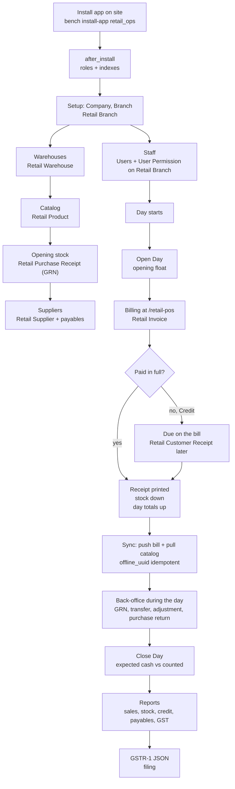

### Setup SOP (once per company, or per new branch)

| # | Who | Do this | Where | Result |
|---|-----|---------|-------|--------|
| 1 | Owner | `bench --site <site> install-app retail_ops` | bench | Three roles created, indexes added |
| 2 | Owner | Create Branch: code, name, currency, GSTIN, state code, footer | Desk → Retail Branch | The branch everything hangs off |
| 3 | Owner | Tick the behaviour switches: offline billing, negative stock, price override, post-close billing, return window, loyalty | Retail Branch → POS Settings / Loyalty Points | Rules the POS enforces |
| 4 | Manager | Create one Warehouse per shelf/room | Desk → Retail Warehouse | Stock is counted per warehouse |
| 5 | Manager | Create Products: barcode, price, MRP, tax rate, category, UOM | Desk → Retail Product | Appears on the POS grid and in the offline catalog |
| 6 | Manager | Receive opening stock on a GRN, with batch/expiry where printed | Desk → Retail Purchase Receipt | Stock On Hand and batch rows exist |
| 7 | Manager | Create Suppliers and their opening bills | Desk → Retail Supplier | Payables report has a starting point |
| 8 | Owner | Create users, give Retail Cashier / Retail Manager, add **User Permission** on the branch | Desk → User | Staff see only their branch |
| 9 | Owner | Optional: offers and loyalty rules | Desk → Retail Offer, Retail Branch | Discounts and points applied at billing |
| 10 | Cashier | Open the browser at `/retail-pos`, pick branch + warehouse | POS | Day is ready to open |

> A branch with no GRN still bills; stock simply goes negative unless the branch
> forbids it.

---

## 2. A day at the counter

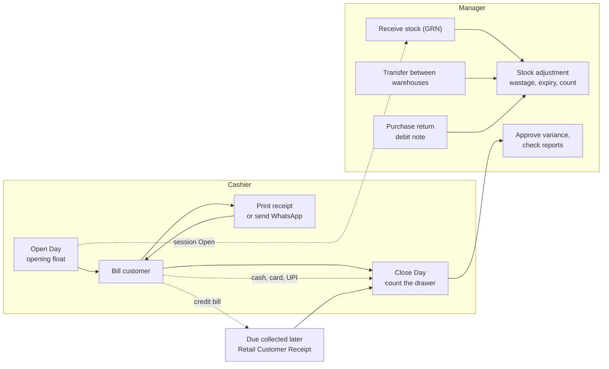

### Opening SOP

| # | Who | Do this | App does |
|---|-----|---------|----------|
| 1 | Cashier | Open `/retail-pos` | Loads cached catalog from IndexedDB, then refreshes it if online |
| 2 | Cashier | Pick Branch and Warehouse | Filters catalog and stock to that warehouse |
| 3 | Cashier | **Open Day**, enter the float | Creates `Retail Day Session` (`Open`), stamps every bill with it |
| 4 | Cashier | Confirm the float matches the drawer | Session totals start from `opening_float` |

Billing is refused until a day is open; branches that allow post-close billing are
the exception.

---

## 3. Billing — the smallest path (small shop)

The simple path is deliberately three actions: scan, take money, print.

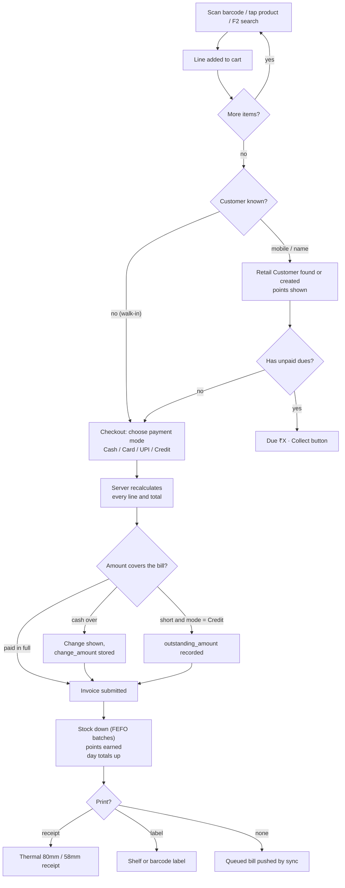

### Billing SOP

| # | Who | Do this | Notes |
|---|-----|---------|-------|
| 1 | Cashier | Scan or tap the product | Out-of-stock still bills if the branch allows negative stock |
| 2 | Cashier | Change qty or price if allowed | Price override only when the branch permits it |
| 3 | Cashier | Optional: mobile number | Points and dues appear under the customer |
| 4 | Cashier | **Checkout**, pick mode, enter tendered amount | Mixed payment = several lines, one of them Credit for the balance |
| 5 | Cashier | Print receipt | Receipt shows bill no., GSTIN, cashier, footer |
| 6 | Cashier | Cancel a wrong bill | Manager-only; stock and totals reverse |

Amounts are always recomputed on the server, so a tampered browser cannot change
a price or a total.

---

## 4. Money flow — where every rupee ends up

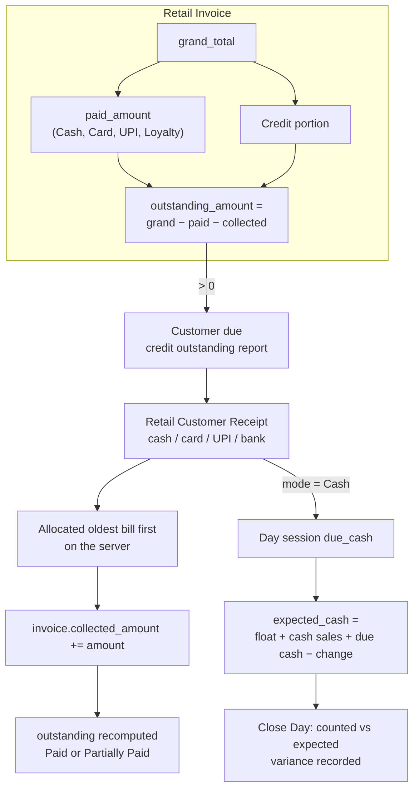

### Collecting a due SOP

| # | Who | Do this | Guard rail |
|---|-----|---------|------------|
| 1 | Cashier | Find the customer by mobile at the counter | Dues are shown per customer |
| 2 | Cashier | Press **Collect** under the customer | Needs a connection — dues are live |
| 3 | Cashier | Enter amount, mode, reference | Receipt for more than is owed is refused |
| 4 | Cashier | Submit | Server settles open bills oldest first, bill statuses update |
| 5 | Manager | Wrong amount? Cancel the receipt | Bills reopen exactly as they were |

There is no per-bill targeting: the oldest due is always cleared first.

---

## 5. Stock — every way goods move

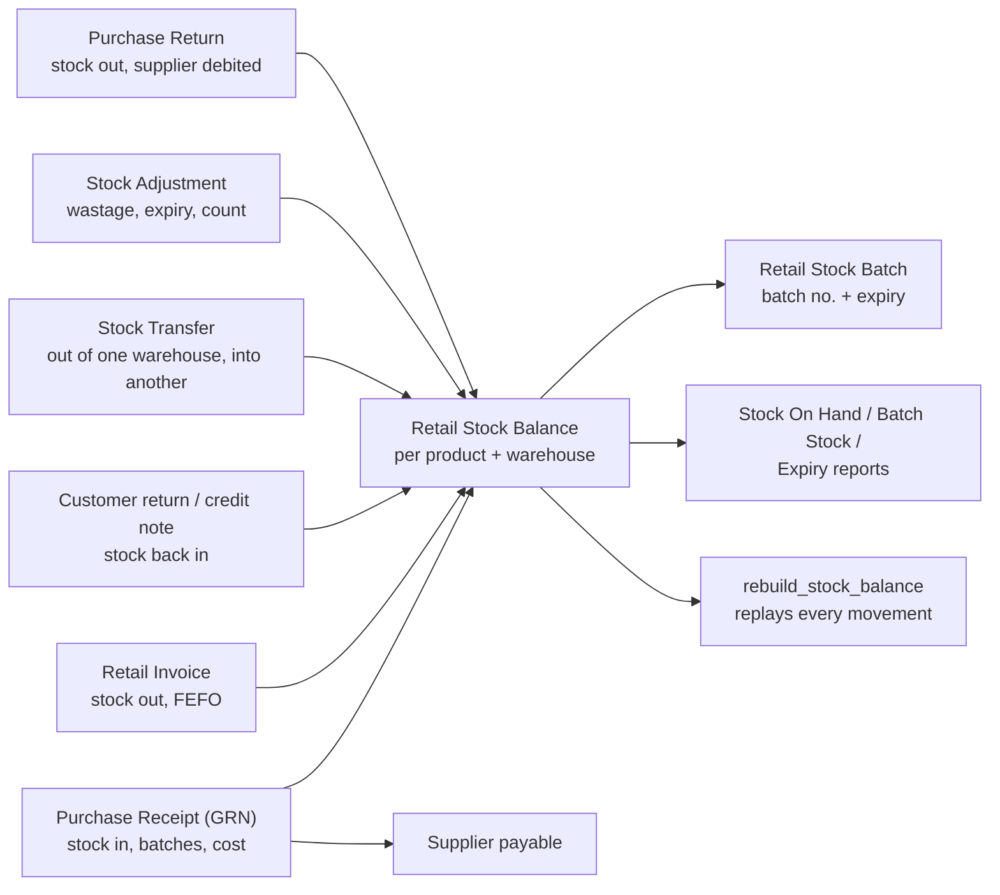

Rules that apply to all of them:

- Nothing goes below zero unless the branch allows negative stock.
- Batches follow the goods; a blank batch issues/consumes earliest expiry first.
- Submitting writes stock, cancelling moves it back — the same amounts, in reverse.
- `rebuild_stock_balance` recomputes from invoices, returns, transfers, adjustments
  and GRNs, so a rebuild is safe.

### Stock SOP

| Case | Document | Who | Step |
|------|----------|-----|------|
| Goods arrive | **Retail Purchase Receipt** | Manager | Supplier, warehouse, lines, batch/expiry, cost → Submit |
| Goods go to a sister shop | **Retail Stock Transfer** | Manager | From branch/warehouse → To branch/warehouse → Submit |
| Broken / expired / miscounted | **Retail Stock Adjustment** | Manager | Reason + signed quantity per line → Submit |
| Goods sent back to supplier | **Retail Purchase Return** | Manager | Against receipt (optional), reason, lines → Submit |
| Customer brings goods back | **Return** at POS | Cashier | Find bill by number or mobile → pick lines → refund mode → Submit |

A count of 7 where the app says 9 is an adjustment of `-2`, not `new = 7`; the
`On Hand` and `New Qty` columns show the effect before you submit.

---

## 6. Suppliers and payables

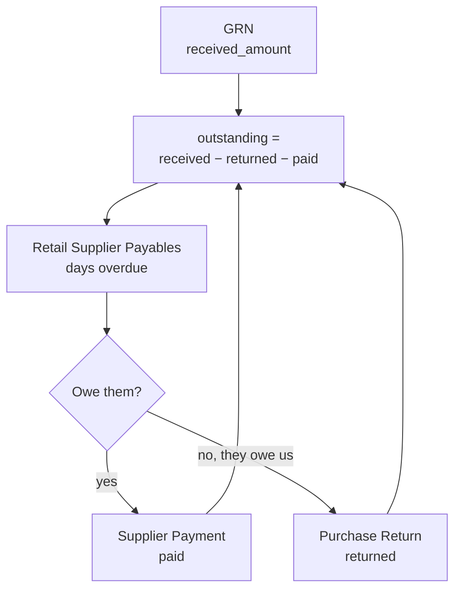

### Payables SOP

| # | Who | Do this | Where |
|---|-----|---------|-------|
| 1 | Manager | Receive goods on a GRN with the supplier's bill number and cost | Desk |
| 2 | Manager | Weekly: open **Retail Supplier Payables**, filter *Only Outstanding* | Desk |
| 3 | Manager | Pay a supplier → **Retail Supplier Payment** | Desk |
| 4 | Manager | Send goods back → **Retail Purchase Return** | Desk |
| 5 | Owner | Month end: reconcile the report against supplier statements | Desk |

---

## 7. Returns at the counter

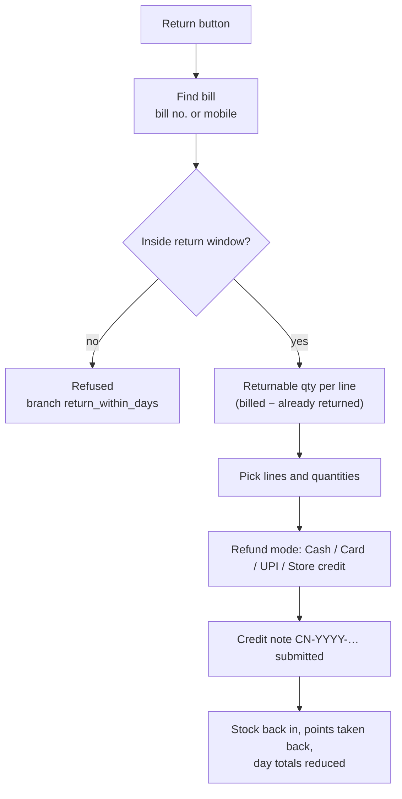

| # | Who | Do this | Note |
|---|-----|---------|------|
| 1 | Cashier | **Return**, search by bill number or the customer's mobile | A bill from another branch is visible only with branch access |
| 2 | Cashier | Choose lines and quantity | Cannot exceed what was billed minus what already came back |
| 3 | Cashier | Refund mode | Store credit refunds nothing from the drawer |
| 4 | Cashier | Submit and print | Credit note is the GST document for the return |

---

## 8. Offline, sync and idempotency

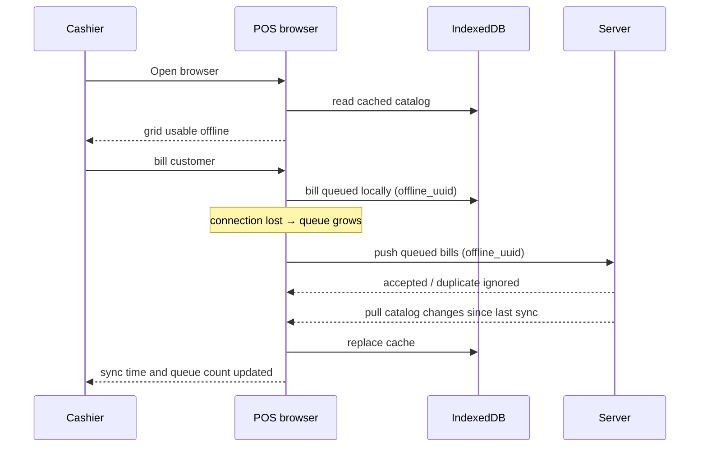

| Situation | Behaviour |
|-----------|-----------|
| No network at bill time | Bill queued locally with an `offline_uuid`, stock and totals applied on push |
| Same bill pushed twice | Server recognises the UUID and never double-books |
| Catalog changed elsewhere | Pulled on next sync; the POS keeps working from the cache meanwhile |
| Two tills, same day | Separate sessions per warehouse; stock is shared |

Dues collection and returns need a connection — they act on live bills.

---

## 9. Closing the day

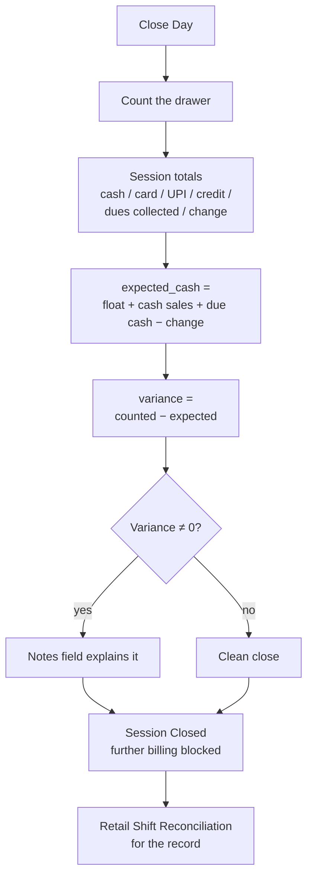

| # | Who | Do this |
|---|-----|---------|
| 1 | Cashier | Count cash and coins, including the float |
| 2 | Cashier | Enter **Closing cash**, add a note for any difference |
| 3 | Cashier | Close Day — the session records expected, counted and variance |
| 4 | Manager | Open **Retail Shift Reconciliation** and initial it |
| 5 | Manager | Deposit the counted cash |

Billing is refused after the close unless the branch allows post-close billing.

---

## 10. Reports and filing

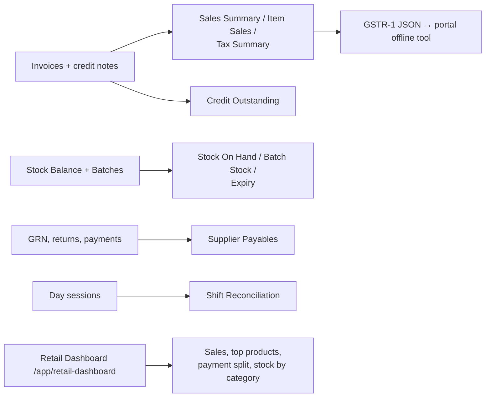

| Cadence | Report | Question it answers |
|---------|--------|---------------------|
| Daily | Shift Reconciliation | Did the drawer balance? |
| Daily | Sales Summary | What sold, by mode and branch |
| Weekly | Stock On Hand, Batch Stock / Expiry | What to reorder, what to pull |
| Weekly | Credit Outstanding | Who owes money, how old |
| Weekly | Supplier Payables | Who we owe, how overdue |
| Monthly | Tax Summary, GSTR-1 JSON | What to file |
| Monthly | Item Sales | What actually earns |

---

## 11. Document map

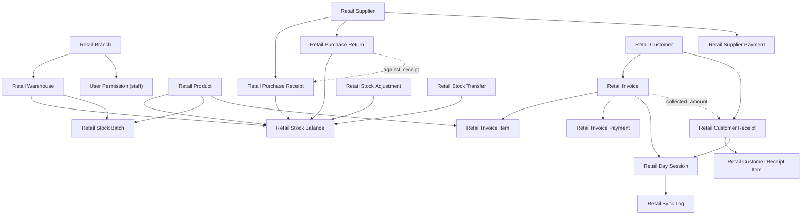

---

## 12. Minimal SOP card (print this for the counter)

```
BEFORE OPENING
  1. Open /retail-pos on the till
  2. Pick Branch + Warehouse
  3. Open Day, count the float, enter it

EVERY SALE
  1. Scan or tap product
  2. Mobile number if the customer has one (points + dues appear)
  3. Checkout -> mode -> amount -> Submit
  4. Print receipt

IF NOT PAID IN FULL
  - Choose Credit for the unpaid part
  - Later: find the customer -> Collect -> amount + mode -> Submit

IF THE CUSTOMER RETURNS SOMETHING
  - Return -> bill no. or mobile -> pick lines -> refund mode -> Submit

AT CLOSING
  1. Count the drawer
  2. Close Day -> enter counted cash + note
  3. Hand over cash with the Shift Reconciliation report

NOT ON THE TILL (manager, Desk)
  - Goods in: Retail Purchase Receipt
  - Goods out to another shop: Retail Stock Transfer
  - Broken/expired/count fix: Retail Stock Adjustment
  - Back to supplier: Retail Purchase Return
  - Supplier paid: Retail Supplier Payment
```
